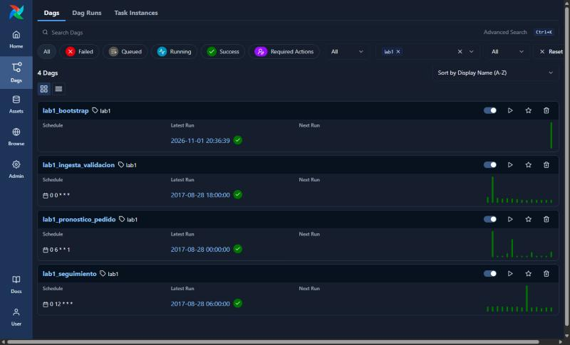
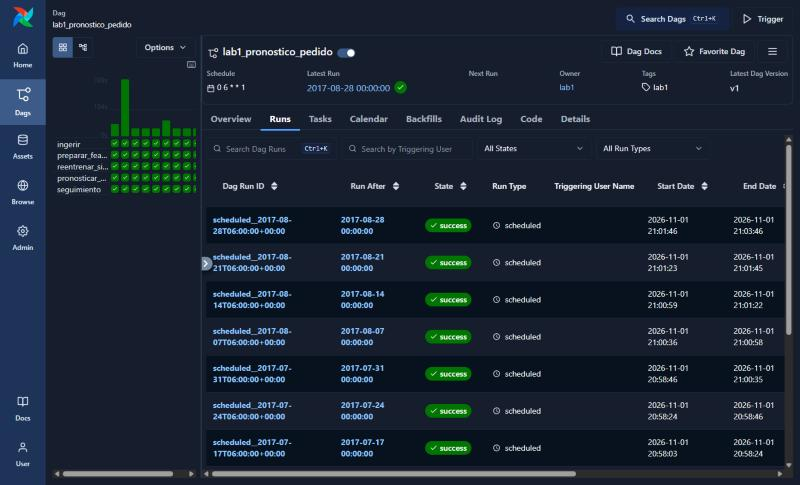
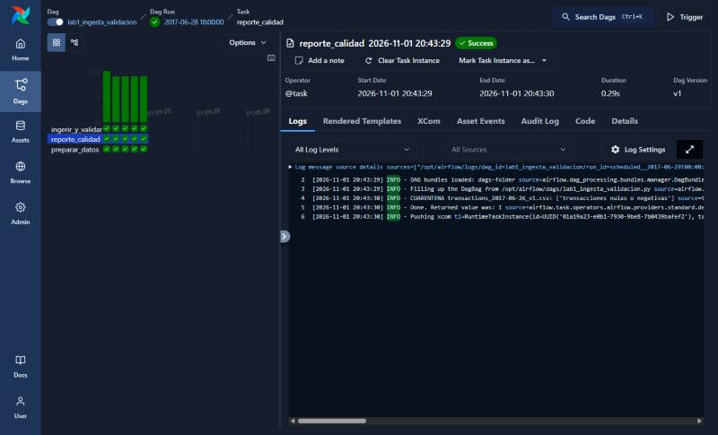
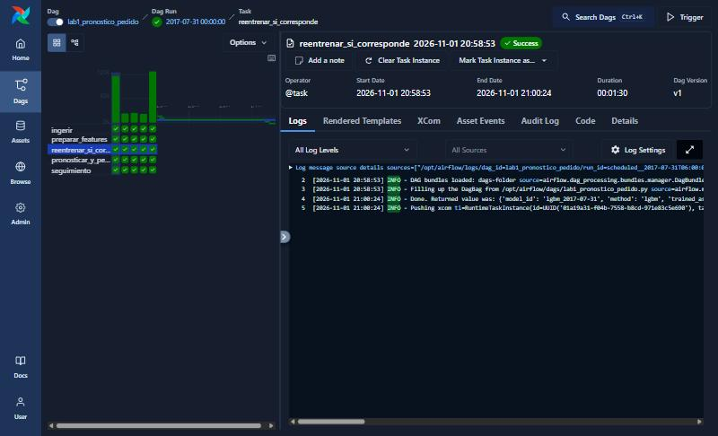

# Motor de Reposición de Inventario — Laboratorio 1 (Product Development)

Producto de ML que, de forma automática y reproducible, transforma datos de ventas que llegan a diario
en un **pronóstico por cuantiles** (14 días, por tienda y familia), un **pedido sugerido** semanal
basado en costos de negocio y un **seguimiento del desempeño** de los pronósticos publicados.
Integra **Git + DVC + Apache Airflow 3** (Docker Compose). Datos: Corporación Favorita (Kaggle).

Las decisiones técnicas y de producto están en [DECISIONES.md](DECISIONES.md).

## Estructura

```
config/params.yaml      # configuración versionada (fechas, horizonte, cuantiles, COSTOS, modelo, política)
src/lab1/               # toda la lógica (los DAGs solo orquestan)
  simulate.py           #   carga histórica + bandeja simulada (sistema de origen)
  ingest.py             #   ingesta, validación, cuarentena y snapshot "as-of"
  features.py           #   features por corte + baseline
  modeling.py           #   LightGBM por cuantiles, backtest temporal, política de campeón, registro
  business.py           #   costos, pedido newsvendor, métricas técnicas y de negocio
  product.py            #   preparación, publicación del pronóstico/pedido, seguimiento
  cli.py                #   ejecución sin Airflow
dags/                   # DAGs de Airflow 3
tests/                  # pytest (corre en cada PR con GitHub Actions)
docker/Dockerfile, docker-compose.yaml
dvc.yaml, *.dvc         # versionado de datos, modelos y pronósticos
reports/                # evidencia: comparación de modelos y seguimiento
```

## Levantar el producto desde cero

Requisitos: Docker (con Docker Compose v2, ≥ 6 GB de RAM para Docker) y Git.

1. Clonar y colocar los archivos de Kaggle **en `kaggle/`** (raíz del repositorio):
   ```bash
   git clone <url-del-repo> lab1 && cd lab1
   mkdir -p kaggle   # copiar aquí train.csv, stores.csv, holidays_events.csv, oil.csv, transactions.csv
   ```
2. Levantar Airflow 3:
   ```bash
   echo "AIRFLOW_UID=$(id -u)" > .env      # en Linux/Codespaces; en Windows/Mac no es necesario
   docker compose up -d --build
   ```
   Interfaz: http://localhost:8080 (sin usuario: `SIMPLE_AUTH_MANAGER_ALL_ADMINS`).
3. En la interfaz (o por CLI), ejecutar el DAG **`lab1_bootstrap`** una vez: crea `data/history`
   (carga histórica hasta `simulation.history_end`) y `data/inbox` (bandeja simulada).
   ```bash
   docker compose exec airflow-scheduler airflow dags trigger lab1_bootstrap
   ```
4. Activar (unpause) los DAGs `lab1_ingesta_validacion`, `lab1_pronostico_pedido` y `lab1_seguimiento`.
   Tienen `catchup=True`: hacen *backfill* automático desde `simulation.inbox_start` hasta
   `simulation.inbox_end + 14 días`, sin intervención manual.
   ```bash
   for d in lab1_ingesta_validacion lab1_pronostico_pedido lab1_seguimiento; do
     docker compose exec airflow-scheduler airflow dags unpause $d; done
   ```
5. Resultados:
   - `data/forecasts/cutoff=<lunes>/forecast.csv` — pronóstico diario P10/P25/P50/P75/P90.
   - `data/forecasts/cutoff=<lunes>/orders.csv` — pedido sugerido semanal por tienda y familia.
   - `data/forecasts/cutoff=<lunes>/meta.json` — modelo, marca de agua de cada fuente, commit, hash de parámetros.
   - `reports/monitoring/monitoring_latest.csv` — seguimiento de pronósticos publicados vs. ventas reales.
   - `models/<id>/meta.json` y `backtest.csv` — comparación de modelos y decisión de reemplazo.
   - `data/quarantine/` — archivos rechazados y su motivo.

### Procesar un periodo distinto (datos nuevos o "no publicados")

La bandeja es un **contrato**: cualquier archivo nuevo con el formato
`data/inbox/<fuente>/arrival=<YYYY-MM-DD>/<fuente>_<fecha_dato>_v<N>.csv`
(fuentes: `sales`, `transactions`, `oil`, `holidays`; mismas columnas que Kaggle) es procesado por el
flujo cuando su fecha de llegada es ≤ a la fecha lógica de la ejecución. Una corrección es el mismo
`fecha_dato` con `vN` mayor. Para cambiar el periodo: ajustar `simulation.*` en `config/params.yaml`
(o lanzar un backfill: `airflow dags backfill lab1_pronostico_pedido -s <inicio> -e <fin>`).

### Reprocesar datos corregidos

Basta con que la corrección llegue a la bandeja: la ingesta diaria la valida y la incorpora; el
seguimiento recalcula las métricas con las ventas corregidas y los siguientes cortes/reentrenamientos
la usan. Para reprocesar un rango pasado: *Clear* de las tareas en la interfaz, o
`docker compose exec airflow-scheduler airflow tasks clear lab1_seguimiento -s <inicio> -e <fin> -y`. Todas las tareas son idempotentes.

## Ejecución local sin Airflow (desarrollo)

```bash
python -m venv .venv && .venv/bin/pip install -r requirements-dev.txt
export PYTHONPATH=src
python -m lab1.cli bootstrap          # historia + bandeja
python -m lab1.cli weekly 2017-07-03  # ingesta + reentrenamiento si toca + pronóstico/pedido
python -m lab1.cli monitor 2017-08-20 # seguimiento
python -m lab1.cli simulate-all       # todo el periodo, día a día
python -m pytest -q
```

## Evidencia

### 1. Comparación de modelos (validación temporal, mismos cortes para todos)

Fuente: [`reports/model_comparison.csv`](reports/model_comparison.csv) (backtest del reentrenamiento del
2017-07-31; horizonte 14 días; cada fold entrena solo con objetivos anteriores a su corte).

| Corte del fold | Modelo   | WAPE  | RMSLE | Pinball | Cobertura P10–P90 | Costo de negocio |
|:---------------|:---------|------:|------:|--------:|------------------:|-----------------:|
| 2017-07-17     | baseline | 0.129 | 0.429 | 22.65   | 0.696             | 1 768 550        |
| 2017-07-17     | lgbm     | 0.126 | 0.409 | 22.03   | 0.773             | 1 652 860        |
| 2017-07-03     | baseline | 0.122 | 0.410 | 21.97   | 0.711             | 1 716 750        |
| 2017-07-03     | lgbm     | 0.114 | 0.383 | 20.18   | 0.815             | 1 473 920        |
| 2017-06-19     | baseline | 0.126 | 0.430 | 22.56   | 0.710             | 1 744 650        |
| 2017-06-19     | lgbm     | 0.120 | 0.400 | 21.67   | 0.801             | 1 527 580        |

Decisiones de reemplazo registradas (`models/<id>/meta.json`, criterio D21 de DECISIONES.md):

| Reentrenamiento | Promovido | Motivo |
|:--|:--|:--|
| lgbm_2017-06-05 | sí | mejora costo de negocio 10.3 % vs baseline (mín. 2 %), WAPE 0.162 vs 0.169 |
| lgbm_2017-07-03 | sí | mejora 9.5 %, WAPE 0.135 vs 0.136 |
| lgbm_2017-07-31 | sí | mejora 11.0 %, WAPE 0.120 vs 0.126 |

### 2. Seguimiento del desempeño de pronósticos publicados

Fuente: [`reports/monitoring/monitoring_latest.csv`](reports/monitoring/monitoring_latest.csv)
(as-of 2017-08-22; compara cada pronóstico publicado contra las ventas reales más recientes, incluidas
correcciones). La cobertura del intervalo P10–P90 se mantiene cerca del 80 % nominal.

| Corte      | Modelo          | Días observados | WAPE  | Cobertura P10–P90 | Costo / unidad vendida |
|:-----------|:----------------|----------------:|------:|------------------:|-----------------------:|
| 2017-06-05 | lgbm_2017-06-05 | 14 | 0.135 | 0.798 | 0.144 |
| 2017-06-12 | lgbm_2017-06-05 | 14 | 0.131 | 0.800 | 0.141 |
| 2017-06-19 | lgbm_2017-06-05 | 14 | 0.121 | 0.817 | 0.128 |
| 2017-06-26 | lgbm_2017-06-05 | 14 | 0.121 | 0.817 | 0.126 |
| 2017-07-03 | lgbm_2017-07-03 | 14 | 0.114 | 0.826 | 0.123 |
| 2017-07-10 | lgbm_2017-07-03 | 14 | 0.125 | 0.809 | 0.136 |
| 2017-07-17 | lgbm_2017-07-03 | 14 | 0.129 | 0.794 | 0.142 |
| 2017-07-24 | lgbm_2017-07-03 | 14 | 0.142 | 0.785 | 0.160 |
| 2017-07-31 | lgbm_2017-07-31 | 14 | 0.167 | 0.775 | 0.169 |
| 2017-08-07 | lgbm_2017-07-31 | 9  | 0.171 | 0.771 | 0.171 |
| 2017-08-14 | lgbm_2017-07-31 | 2  | 0.121 | 0.795 | 0.124 |
| 2017-08-21 | lgbm_2017-07-31 | 0  | —     | —     | —     |

Situaciones operativas observadas en la corrida (bandeja simulada):
- `sales_2017-07-09_v1` llegó sin la columna `sales` → **cuarentena**; el corte del 2017-07-10 se emitió
  con marca de agua de ventas 2017-07-08 (sin fallar) y la v2 reenviada se incorporó el 2017-07-12.
- `transactions_2017-06-26_v1` con valores negativos → **cuarentena**; el modelo siguió con las demás fuentes.
- 6 días de ventas recibieron corrección (v2) 4 días después; el seguimiento usa la versión corregida y
  los pronósticos ya publicados no cambian.

### 3. Reproducción de un pronóstico pasado con DVC

Desde un clon limpio, se recupera el pronóstico publicado del corte 2017-07-03 desde el remoto DVC, se
borra **todo lo derivado** (lago, features, modelos, pronósticos) y se reconstruye desde la bandeja con el
mismo código. Los hashes coinciden byte a byte (salida real, ver [`docs/repro_evidence.txt`](docs/repro_evidence.txt)):

```
$ git clone <repo> && cd <repo> && git checkout f3ffce0
$ dvc pull
545 files fetched and 537 files added
$ sha256sum data/forecasts/cutoff=2017-07-03/forecast.csv data/forecasts/cutoff=2017-07-03/orders.csv   # publicado
a6a58cf95c3f5f9ec6147e1a3c7494e718f46e7b11d318fd1e1113dbe35a10c1 *data/forecasts/cutoff=2017-07-03/forecast.csv
d793de67e699adc2f3d7ada99a86eb07183a7b5a19af6d50bfbd54e0d3baa887 *data/forecasts/cutoff=2017-07-03/orders.csv
$ rm -rf data/lake data/features data/forecasts models
$ python -m lab1.cli weekly 2017-06-05 > /dev/null   # reconstruye el campeón vigente antes del corte
$ python -m lab1.cli weekly 2017-07-03 > /dev/null   # ingesta as-of, reentrena y reemite el corte
$ sha256sum data/forecasts/cutoff=2017-07-03/forecast.csv data/forecasts/cutoff=2017-07-03/orders.csv   # reproducido
a6a58cf95c3f5f9ec6147e1a3c7494e718f46e7b11d318fd1e1113dbe35a10c1 *data/forecasts/cutoff=2017-07-03/forecast.csv
d793de67e699adc2f3d7ada99a86eb07183a7b5a19af6d50bfbd54e0d3baa887 *data/forecasts/cutoff=2017-07-03/orders.csv
```

Para reproducir cualquier otro corte publicado: `git checkout <commit>` + `dvc pull` recupera el
pronóstico, el modelo y los datos de esa versión; re-ejecutar `python -m lab1.cli forecast <corte>`
con los datos recuperados vuelve a producir el mismo archivo (el snapshot as-of del corte no cambia).

### 4. Ejecuciones en Airflow

Corrida completa desde cero con este `docker-compose.yaml` (Airflow 3.1, LocalExecutor) en GitHub
Codespaces, siguiendo exactamente los pasos de "Levantar el producto desde cero": `lab1_bootstrap`
manual y luego *backfill* automático de 2017-06-01 a 2017-08-29, sin intervención manual sobre los datos.
Resultado: **90/90** runs de `lab1_ingesta_validacion`, **13/13** de `lab1_pronostico_pedido` (4
reentrenamientos, todos promovidos) y **89/89** de `lab1_seguimiento` (corre a las 12:00; el último día del rango cae después de `end_date`).

| | |
|:--|:--|
|  |  |
| Los 4 DAGs, último run exitoso | 13 cortes semanales; las barras altas son los reentrenamientos |
|  |  |
| `reporte_calidad`: el archivo con transacciones negativas va a cuarentena y el run sigue en verde | `reentrenar_si_corresponde` del 2017-07-31: modelo nuevo y decisión de promoción |

Reportes generados por esa corrida de Airflow: [`reports/airflow/model_comparison.csv`](reports/airflow/model_comparison.csv)
(backtest del reentrenamiento del 2017-08-28), [`reports/airflow/monitoring_latest.csv`](reports/airflow/monitoring_latest.csv)
y un ejemplo de pedido sugerido: [`reports/airflow/orders_2017-08-28.csv`](reports/airflow/orders_2017-08-28.csv).

| Reentrenamiento (Airflow) | Promovido | Motivo |
|:--|:--|:--|
| lgbm_2017-06-05 | sí | mejora costo de negocio 11.0 % vs baseline, WAPE 0.162 vs 0.169 |
| lgbm_2017-07-03 | sí | mejora 10.7 %, WAPE 0.135 vs 0.136 |
| lgbm_2017-07-31 | sí | mejora 12.0 %, WAPE 0.123 vs 0.126 |
| lgbm_2017-08-28 | sí | mejora 14.0 %, WAPE 0.135 vs 0.147 |

Durante esta validación aparecieron (y se corrigieron, ver historial del PR) dos problemas que solo se
ven en Airflow real: XCom de Airflow 3 rechaza `NaN` (el seguimiento ahora devuelve un resumen) y la CLI
de Airflow no agrega `dags/` al `sys.path` (la configuración común vive en `lab1.dag_config`).

> Nota: los números de la corrida en Airflow (Linux, contenedor) difieren levemente de la corrida local
> (Windows) de las secciones 1–3, porque LightGBM no es bit a bit idéntico entre plataformas. Dentro de
> un mismo entorno el resultado sí es determinista (ver DECISIONES D25).
